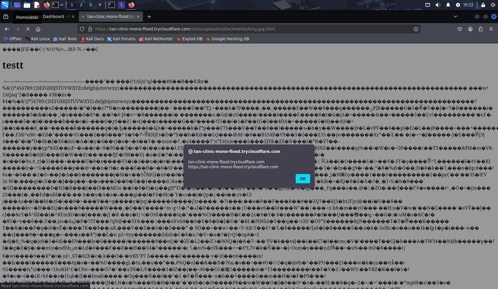
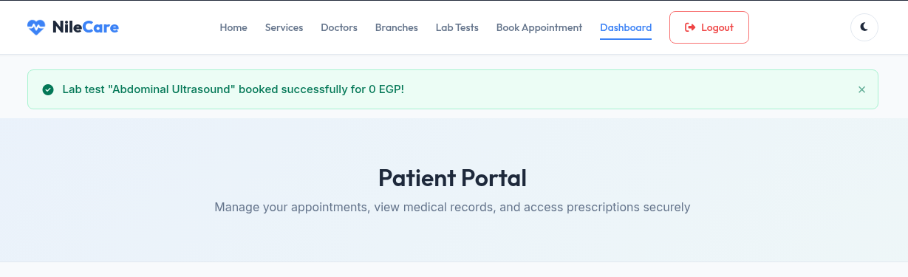
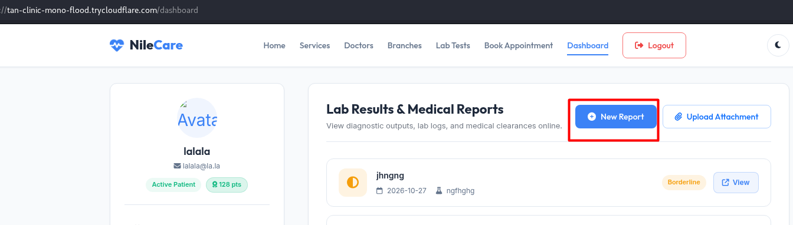
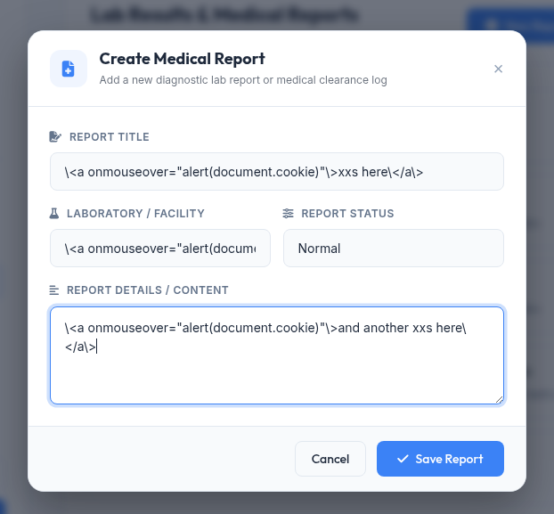
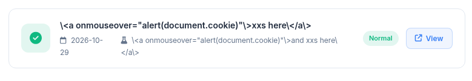
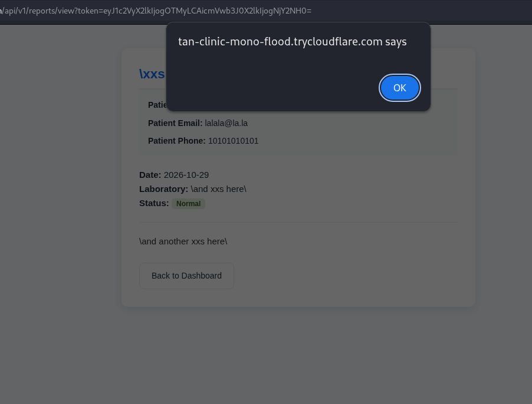

# NileCare - Security Findings

**Application:** NileCare / Egyptian Specialist Hospital

**Assessment period:** 25-29 October 2026

**Report version:** 2.1

## Overview

The assessment identified **six confirmed vulnerabilities** in the NileCare patient portal. These affect uploaded medical attachments, appointment authorization, doctor-directory data, laboratory discounts, password recovery and medical-report rendering.

The password-recovery flaw allows an unauthenticated requester to obtain a recovery link and take over an account. The booking IDOR permits appointment creation under another patient's identity. Two separate stored-XSS vulnerabilities execute JavaScript through uploaded HTML attachments and medical-report fields. The lab-booking workflow accepts an unauthorized client-supplied discount, while the public doctors API exposes staff email addresses and related directory records.

The report contains the team's reproduction steps, affected endpoints, impact and remediation for these six findings. Screenshots accompany the available demonstrations. The `/api/doctors` response is documented without a screenshot, as none was supplied. Passwords, signing secrets, usable session cookies and reset-token values are excluded.

### Remediation priorities
1. Fix password recovery and enforce patient ownership throughout the appointment-booking workflow.
2. Prevent active HTML in uploaded attachments and encode all medical-report fields at output.
3. Compute laboratory prices and discounts on the server, and remove unnecessary staff contact data from public API responses.

| ID | Finding | Status |
|---|---|---|
| 01 | Stored Cross-Site Scripting (XSS) - Attachment Upload | Confirmed |
| 02 | Insecure Direct Object Reference (IDOR) | Confirmed |
| 03 | Information Disclosure - Doctor Details and Email Addresses | Confirmed |
| 04 | Business Logic Flaw - Client-Controlled Discount | Confirmed |
| 05 | Forgot Password - Unauthenticated Password Reset / Account Takeover | Confirmed |
| 06 | Stored Cross-Site Scripting (XSS) - Medical Report Fields | Confirmed |

---

## 01 | Stored Cross-Site Scripting (XSS) - Attachment Upload

**Affected components:** `POST /reports/upload-attachment`, `/static/uploads/attachments/<uploaded-file>`

**CVSS 3.1 vector:** `CVSS:3.1/AV:N/AC:L/PR:L/UI:R/S:U/C:H/I:H/A:N`

**Status: Confirmed**

The medical-attachment uploader accepts a JPEG/HTML polyglot whose filename contains an allowed image extension but ends in .html. The file is stored publicly and served as HTML. Opening the uploaded URL executes attacker-controlled JavaScript in the NileCare origin.

### Affected input and behavior
The multipart input is `attachment`. The demonstrated filename pattern is `king.jpg.html`, with declared content type `image/jpeg` and JPEG signature bytes followed by HTML and JavaScript. The upload filter accepts the image extension appearing inside the filename; the final `.html` extension causes the stored content to be served as `text/html` with inline disposition.

### Steps to reproduce
1. Sign in to the patient portal and open the attachment-upload form.
2. Prepare JPEG-header content followed by benign HTML and an alert using `document.domain` or `window.origin`.
3. Upload it as `king.jpg.html` through the `attachment` field.
4. Follow the uploaded-file link under `/static/uploads/attachments/`.
5. Observe the browser alert displaying the NileCare origin.

### Request and response
```http
POST /reports/upload-attachment HTTP/1.1
Host: tan-clinic-mono-flood.trycloudflare.com
Cookie: session=[REDACTED]
Content-Type: multipart/form-data; boundary=NileCareEvidence

--NileCareEvidence
Content-Disposition: form-data; name="attachment"; filename="king.jpg.html"
Content-Type: image/jpeg

[JPEG header bytes followed by HTML and a benign alert script]
--NileCareEvidence--
```
The server redirects to `/dashboard` after upload. Retrieving the uploaded URL returns `200 OK` with `Content-Type: text/html` and an inline content disposition.

### Impact
Stored, same-origin JavaScript can read page content, alter displayed information and issue authenticated requests in a logged-in visitor's context. The malicious content remains available at its uploaded URL. The demonstrated interaction is opening the attachment link.

### Evidence



### Recommendation

Validate the final filename extension against an allowlist and verify file content. Decode and re-encode uploaded images, generate server-side storage names, and keep medical attachments outside the public web root. Serve files through an authorization-checked download route and prevent user uploads from becoming active HTML on the application origin. Add a restrictive CSP and `X-Content-Type-Options: nosniff` as additional controls.

### References

- [https://cwe.mitre.org/data/definitions/79.html](https://cwe.mitre.org/data/definitions/79.html)
- [https://cwe.mitre.org/data/definitions/434.html](https://cwe.mitre.org/data/definitions/434.html)
- [https://cheatsheetseries.owasp.org/cheatsheets/File_Upload_Cheat_Sheet.html](https://cheatsheetseries.owasp.org/cheatsheets/File_Upload_Cheat_Sheet.html)

---

## 02 — Insecure Direct Object Reference (IDOR)

---

1. Executive Summary
An Insecure Direct Object Reference (IDOR) / Broken Access Control vulnerability exists within the NileCare Patient Portal booking system. The application relies on a client-side modifiable session cookie (using URL-safe timed serialization without signature enforcement verification) to identify the authenticated user. By decoding the session payload, modifying identity parameters (`user_id`, `patient_name`, `patient_email`), and re-encoding the token, an attacker can manipulate session state to schedule medical appointments on behalf of arbitrary victims.
---
2. Vulnerability Overview
Vulnerability Type: Insecure Direct Object Reference (IDOR) / Broken Access Control / Insecure Session Management.
Affected Application: NileCare Patient Portal (https://tan-clinic-mono-flood.trycloudflare.com).
Affected Endpoint: `POST /book`.
Severity: High (CVSS v3.1 Score: 7.5 - `CVSS:3.1/AV:N/AC:L/PR:N/UI:N/S:U/C:N/I:H/A:N`).
Impact: Unauthorized appointment creation for arbitrary users, potential schedule/calendar tampering, and loss of integrity in patient booking records.
---
3. Technical Details & Root Cause Analysis
Root Cause
The NileCare application uses a `URLSafeTimedSerializer` (zlib deflated JSON structure) to serialize user identity into the `session` cookie. The server processes booking requests at `/book` by trusting the identity stored within this session object without verifying a cryptographic signature or matching the request identity against server-side session state.
Decoded Session Cookie Payload
Decoding the `session` cookie via tools (e.g., `[https://hackindex.io/](https://hackindex.io/)`) reveals the unverified JSON structure:
```
json
{
  "patient_email": "kk@kk",
  "patient_name": "inAct",
  "user_id": 1322
}
 
```
 Because the HMAC signature is either not verified or absent during request authorization, an attacker can replace `user_id`, `patient_name`, and `patient_email` with victim parameters (e.g., `ff@ff`) and submit modified booking requests.

---

4. Proof of Concept (PoC) Steps
Session Interception & Decoding:
Log into the NileCare portal and initiate a appointment booking request using the account kk@kk.


Capture the request in Burp Suite and extract the `session` cookie value.


Decode the session cookie using `https://hackindex.io/` or Flask session decoding utilities, revealing the payload attributes (`patient_email`, `patient_name`, `user_id`).


Payload Modification & Encoding:
Modify the payload attributes to target the victim account (`ffff` / `ff@ff`):
```json
{
  "patient_email": "ff@ff",
  "patient_name": "ffff",
  "user_id": <VICTIM_ID>
}
 
```

Encode the modified JSON structure using the `URLSafeTimedSerializer` format.
Exploitation / Request Submission:
Send a `POST /book` request with the modified `session` cookie:
The server responds with `HTTP/2 302 Found` redirecting to `/dashboard`.


Verification:
Accessing the victim's dashboard (`ff@ff`) confirms that the appointment for Dr. Ahmed El-Sherbiny was successfully booked under the victim's account profile.

`ff@ff before the exploitation`


`ff@ff after the exploitation`


---
5. Impact
Data Integrity Violation: Attackers can book unintended medical appointments, clog clinic schedules, and distort medical records for arbitrary users.
Resource Exhaustion: Malicious actors can automate appointment bookings to lock out real patients from booking valid slots.
Unauthorized Account Manipulation: Allows identity impersonation across action endpoints relying on the deserialized session object.
---
6. Remediation Guidelines
Enforce Cryptographic Signing & Validation:
Ensure session cookies are signed using a strong, secret key (`SECRET_KEY`) and that signatures are strictly validated on every HTTP request before deserializing state.
Server-Side Session Storage:
Transition from storing user identification data inside client-side cookies to storing session state exclusively server-side (e.g., Redis, database session store), referencing it via a cryptographically random session identifier.
Strict Authorization Checks:
Validate that the authenticated user performing the action matches the server-side identity associated with the session before executing write operations on `/book`.
`Discovered and tested by Abdulaziz Soltan, aka k0rdz`

## 03 | Information Disclosure - Doctor Details and Email Addresses

**Affected components:** `GET /api/doctors`

**CVSS 3.1 vector:** `CVSS:3.1/AV:N/AC:L/PR:N/UI:N/S:U/C:L/I:N/A:N`

**Status: Confirmed**

The unauthenticated doctors API exposes structured records for 22 doctors, including their email addresses under @nilecare.com.eg. The response also contains names, specialties, schedules, experience and biographical details. Any visitor can retrieve the records without a session.

### Steps to reproduce
1. Open a client without an authenticated session.
2. Send a GET request to `/api/doctors`.
3. Inspect the JSON response and the email field in each doctor record.

```http
GET /api/doctors HTTP/1.1
Host: tan-clinic-mono-flood.trycloudflare.com
Accept: application/json
```

### Exposed data
The documented response contains 22 records with doctor names, specialties, biographies, years of experience, ratings, weekly schedules and email addresses. The email domain is `nilecare.com.eg`.

### Impact
Unauthenticated users can collect the doctors' contact details and schedules in bulk. The disclosed addresses support targeted phishing, impersonation and unsolicited contact.

### Evidence
The endpoint and response fields are documented in the team's assessment. A screenshot of this API response was not supplied.

### Recommendation

Remove unnecessary email and staff-contact fields from unauthenticated API responses. Return only the attributes needed by the public directory and require appropriate authorization for additional staff data. Apply response minimization, access logging and suitable request limits.

### References

- [https://cwe.mitre.org/data/definitions/862.html](https://cwe.mitre.org/data/definitions/862.html)
- [https://cheatsheetseries.owasp.org/cheatsheets/Authorization_Cheat_Sheet.html](https://cheatsheetseries.owasp.org/cheatsheets/Authorization_Cheat_Sheet.html)

---

## 04 | Business Logic Flaw - Client-Controlled Discount

**Affected components:** `POST /lab-tests/book`

**CVSS 3.1 vector:** `CVSS:3.1/AV:N/AC:L/PR:L/UI:N/S:U/C:N/I:H/A:N`

**Status: Confirmed**

The lab-booking endpoint trusts the discount_pct parameter supplied by the client instead of calculating the permitted discount on the server. A valid promotion code can be combined with an altered percentage to reduce the payable price beyond the code's intended discount.

### Technical details
The booking request contains `test_id`, `discount_pct` and `discount_code`. The documented controlled test combines the public code `NILECARE10` with `discount_pct=90`, and the server records a 90% discount. Invalid promotion codes are rejected, but accepting a valid code does not restrict the supplied percentage to that code's actual allowance.

### Steps to reproduce
1. Sign in and select a laboratory test.
2. Capture the request to `/lab-tests/book`.
3. Retain a valid discount code and replace `discount_pct` with a larger percentage.
4. Submit the modified request.
5. Verify the reduced payable price in the success message and stored booking.

```http
POST /lab-tests/book HTTP/1.1
Host: tan-clinic-mono-flood.trycloudflare.com
Cookie: session=[REDACTED]
Content-Type: application/x-www-form-urlencoded

test_id=1&discount_pct=90&discount_code=NILECARE10
```

### Impact
A patient can obtain an unauthorized reduction in laboratory-test prices. The supplied team screenshot shows an Abdominal Ultrasound successfully booked for **0 EGP**, demonstrating the financial impact of manipulated booking prices.

### Evidence



### Recommendation

Calculate the discount and final price on the server using trusted product prices and promotion rules. Ignore client-provided percentages, validate code eligibility and usage limits, and use exact currency arithmetic. Audit anomalous bookings and test that changing discount_pct cannot change the server-authorized amount.

### References

- [https://cwe.mitre.org/data/definitions/602.html](https://cwe.mitre.org/data/definitions/602.html)
- [https://cwe.mitre.org/data/definitions/840.html](https://cwe.mitre.org/data/definitions/840.html)

---

## 05 - Insecure Password Reset Token Exposure & Permanent Reusability

---

1. Executive Summary
A critical security vulnerability resides in the password reset mechanism of the NileCare application (`https://tan-clinic-mono-flood.trycloudflare.com`). While traffic is protected by transport-layer encryption (HTTPS), the application introduces severe risks by explicitly exposing the password reset token in the HTTP response body and utilizing static, non-expiring, and reusable tokens tied permanently to user accounts. This combination enables persistent Account Takeover (ATO) vectors through information disclosure, referrer header leaks, or browser history caching.
---
2. Vulnerability Overview
Vulnerability Type: Sensitive Information Disclosure & Permanent/Reusable Password Reset Token (Leading to Account Takeover).
Affected Application: NileCare Patient Portal (`https://tan-clinic-mono-flood.trycloudflare.com`).
Affected Endpoint: `POST /forgot-password`.
Severity: Critical (CVSS v3.1 Score: 8.6 - `CVSS:3.1/AV:N/AC:L/PR:N/UI:N/S:U/C:H/I:H/A:N`).
Impact: Full Account Takeover (ATO), persistent unauthorized access, and complete bypass of authentication mechanisms.
---
3. Technical Details & Root Cause Analysis

Transport Encryption: Because the application operates over HTTPS, the token cannot be captured via passive plain-text network sniffing (such as packet inspection on a local network).
The Actual Flaw (Information Disclosure & Reusability): The vulnerability does not stem from transit sniffing, but rather from server-side disclosure:
Response Body Leak: When a password reset is requested for an account (`kk@kk`), the server returns the unique token and reset URL directly inside the HTTP response body.
URL Parameter Exposure: The token is passed as a GET parameter (`?token=1d4db8800978483ef04a31e92f6ed3ca`), making it vulnerable to leakage via `Referer` headers, browser history, or server access logs.
Permanent Lifetime: The token never expires and is never invalidated after use, meaning once discovered, it can be used repeatedly to perform continuous account takeovers.

---

4. Proof of Concept (PoC) Steps
Triggering the Reset Request:
Submit a target email address (`kk@kk`) via a `POST` request to the password recovery endpoint.
Observing the Information Disclosure:
Inspect the HTTP response body. The application explicitly prints the raw reset URL containing the static token (`1d4db8800978483ef04a31e92f6ed3ca`).


Executing Account Takeover:
Navigate to the URL over HTTPS (`https://tan-clinic-mono-flood.trycloudflare.com/reset-password?token=...`).
Input a new password to successfully compromise the victim's account.


Validating Persistent Reusability:
Attempt to reuse the exact same token URL again; confirm that the token remains valid indefinitely, allowing an attacker to regain entry at any time even after passwords are changed.


---

5. Impact
Account Takeover (ATO): Any exposure of the response body or URL allows an attacker to instantly take over the victim's account.
Permanent Backdoor: Because the token is static and non-expiring, changing the password does not revoke the token, giving an adversary permanent, long-term access.
---
6. Remediation Guidelines
Eliminate Response Body Disclosure:
Never return password reset tokens or reset links directly in HTTP response bodies. Transmit reset links exclusively through secure, out-of-band communication channels (such as verified user emails).
Implement Token Expiration & Single-Use Rules:
Generate cryptographically secure, randomized tokens with a short lifespan (e.g., 15 minutes).
Ensure tokens are single-use and are automatically invalidated in the database immediately after a password reset is completed.
Token Rotation:
Ensure requesting a new reset token or successfully changing a password invalidates all prior tokens associated with the account.
`Discovered and tested by Abdulaziz Soltan, aka k0rdz`
---

## 06 | Stored Cross-Site Scripting (XSS) - Medical Report Fields

**Affected components:** `POST /reports/create`, `GET /api/v1/reports/view`, `Fields: title, lab, report_file`

**CVSS 3.1 vector:** `CVSS:3.1/AV:N/AC:L/PR:L/UI:R/S:C/C:L/I:L/A:N`

**Status: Confirmed**

The Report Title, Laboratory / Facility and Report Details / Content fields store attacker-controlled HTML. The dashboard list displays the saved values as text, but the report view renders the same values as active HTML. Hovering over an injected link executes JavaScript in the NileCare origin. This stored XSS is separate from the attachment-upload vulnerability.

### Technical details
The affected inputs are `title`, `lab` and `report_file` in the Create Medical Report form. Contextual output encoding is missing on `/api/v1/reports/view`, allowing a stored anchor element and its `onmouseover` handler to be interpreted by the browser.

The test used the following payload forms; the submitted screenshots also show literal backslash characters around the markup:
```html
<!-- Report Title -->
<a onmouseover="alert(document.cookie)">xxs here</a>
<!-- Laboratory / Facility -->
<a onmouseover="alert(document.cookie)">and xxs here</a>
<!-- Report Details / Content -->
<a onmouseover="alert(document.cookie)">and another xxs here</a>
```

### Steps to reproduce
1. Sign in as a patient and open the Dashboard.
2. Click **New Report** under Lab Results & Medical Reports.
3. Enter the payloads in Report Title, Laboratory / Facility and Report Details / Content, then save.
4. Confirm the new report appears in the dashboard with the payload displayed as text.
5. Click **View** to open the report.
6. Hover over an injected link. The browser displays a JavaScript alert from the NileCare origin.

### Impact
Stored report data executes JavaScript when the report is viewed and the injected element is triggered. This enables page-content manipulation, phishing content and same-origin actions in the viewer's session. The demonstrated `document.cookie` alert is empty; the evidence establishes script execution without asserting theft of the HttpOnly session cookie.

### Evidence









### Recommendation

Apply contextual output encoding to title, laboratory, status and report content wherever they are rendered. Enable template autoescaping and avoid unsafe Markup, safe filters and HTML insertion for plain-text fields. If rich text is required, use a maintained allowlist sanitizer. Add a restrictive CSP that blocks inline scripts and event handlers, and retain HttpOnly, Secure and SameSite session protections.

### References

- [https://cwe.mitre.org/data/definitions/79.html](https://cwe.mitre.org/data/definitions/79.html)
- [https://cheatsheetseries.owasp.org/cheatsheets/Cross_Site_Scripting_Prevention_Cheat_Sheet.html](https://cheatsheetseries.owasp.org/cheatsheets/Cross_Site_Scripting_Prevention_Cheat_Sheet.html)
