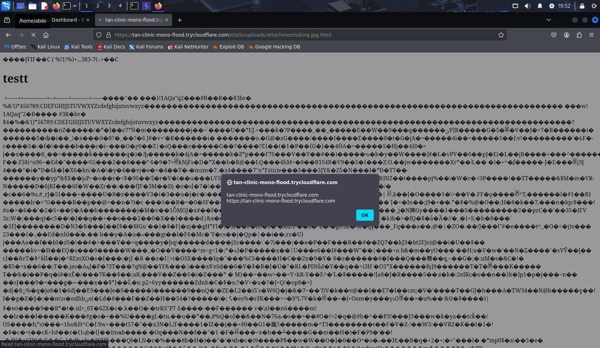
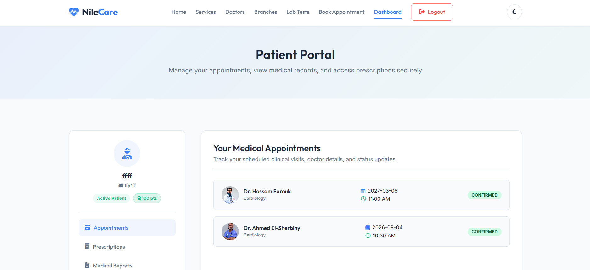
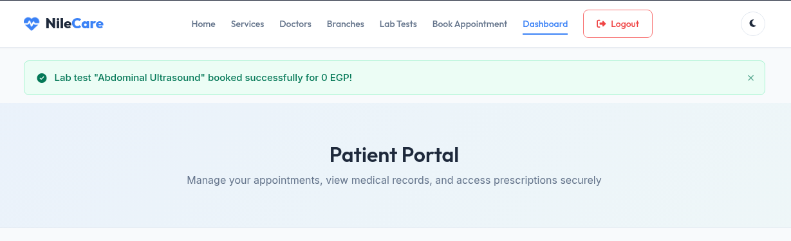

<div align="center">

# 🛡️ HINDAWI FINAL PROJECT
### NileCare | Web Application Penetration Testing

**A hands-on web security assessment focused on identifying, validating, and documenting real-world vulnerabilities.**


[📄 Full Pentest Report](report/NileCare_Consolidated_Pentest_Report.pdf) | [🔍 Technical Findings](NileCare_Security_Findings_Summary.md) | [🧪 Reconnaissance Report](NileCare_Negative_Testing_and_Reconnaissance_Report.pdf)

</div>

---

## 🎯 Project Overview

**Hindawi Final Project** is a practical web application penetration testing assessment conducted against **NileCare**, a healthcare patient portal.

The objective was to evaluate the application's security posture, identify vulnerabilities, demonstrate their potential impact, and provide actionable remediation recommendations.

The assessment covered:

- Authentication and session management
- Access control and authorization
- Cross-Site Scripting (XSS)
- File upload security
- Business logic vulnerabilities
- Sensitive information disclosure
- Password recovery mechanisms

Through manual security testing and controlled exploitation, the team documented **6 confirmed vulnerabilities**, supported by technical evidence and remediation guidance.

## 📊 Assessment Summary

| Metric | Result |
|---|---|
| Target | NileCare Patient Portal |
| Assessment Type | Web Application Penetration Testing |
| Assessment Period | October 25–29, 2026 |
| Confirmed Vulnerabilities | 6 |
| Critical Findings | 1 |
| High Findings | 2 |
| Medium Findings | 3 |
| Documentation | Technical Reports & Evidence |

## 🚨 Security Findings

| ID | Vulnerability | Severity | CVSS |
|---|---|---|---|
| 01 | Stored XSS – File Upload | 🟠 High | 7.3 |
| 02 | IDOR / Broken Access Control | 🟠 High | 7.5 |
| 03 | Information Disclosure | 🟡 Medium | 5.3 |
| 04 | Business Logic – Discount Manipulation | 🟡 Medium | 6.5 |
| 05 | Insecure Password Reset / Account Takeover | 🔴 Critical | 9.1 |
| 06 | Stored XSS – Medical Report Fields | 🟡 Medium | 5.4 |

*Severity classifications are based on the consolidated assessment report and reflect the assessment period, not the current security state of the application.*

## 🔬 Highlighted Vulnerabilities

### 01 — Stored Cross-Site Scripting (XSS)

**Severity: High**

The application allowed specially crafted uploaded attachments to be served as active HTML, resulting in JavaScript execution within the application origin.

**Impact:** Client-side code execution, potential page manipulation, and unauthorized actions within an authenticated user's session.



### 02 — Insecure Direct Object Reference (IDOR)

**Severity: High**

Insufficient server-side authorization allowed manipulated identity information to be used during appointment booking.

**Impact:** Unauthorized appointment creation under another patient's identity.



### 03 — Business Logic Vulnerability

**Severity: Medium**

The laboratory booking workflow trusted a discount percentage supplied by the client rather than enforcing the authorized discount server-side.

**Impact:** Unauthorized price reductions, including a documented booking with a zero payable amount.



### 04 — Insecure Password Reset

**Severity: Critical**

The password recovery process exposed reset links to unauthenticated requesters, with tokens remaining usable after successful password resets.

**Impact:** Unauthorized account takeover and repeated account compromise.

[View the documented evidence](report/NileCare_Consolidated_Pentest_Report.md)

## 🛠️ Tools & Techniques

**Burp Suite** — HTTP request interception, analysis, and manipulation.

**Browser Testing** — Manual verification, proof-of-concept execution, and screenshot collection.

**API Security Testing** — Endpoint inspection, information exposure analysis, and authorization checks.

**Session Analysis** — Understanding authentication and session-based access control weaknesses.

**CVSS v3.1** — Risk classification and severity assessment.

## 🔄 Penetration Testing Methodology

```text
01  Reconnaissance
         |
         v
02  Attack Surface Analysis
         |
         v
03  Vulnerability Identification
         |
         v
04  Controlled Exploitation
         |
         v
05  Impact Validation
         |
         v
06  Evidence Collection
         |
         v
07  Risk Assessment
         |
         v
08  Reporting & Remediation
```

## 📁 Repository Structure

```text
hindawi-final-project/
|
|-- README.md
|
|-- NileCare_Security_Findings_Summary.md
|
|-- NileCare_Negative_Testing_and_Reconnaissance_Report.pdf
|
|-- Images/
|   |-- Original assessment screenshots
|
|-- report/
    |-- NileCare_Consolidated_Pentest_Report.pdf
    |-- NileCare_Consolidated_Pentest_Report.md
    |
    |-- evidence/
    |   |-- Vulnerability screenshots
    |   |-- HTTP request/response evidence
    |
    |-- assets/
        |-- Report graphics
```

## 📚 Documentation

### Final Penetration Test Report

The consolidated report includes detailed vulnerability descriptions, technical impact, supporting evidence, and remediation recommendations.

**[Read Full Report (PDF)](report/NileCare_Consolidated_Pentest_Report.pdf)**

### Security Findings Summary

A technical breakdown of all six confirmed vulnerabilities, including reproduction steps and supporting screenshots.

**[Explore Technical Findings](NileCare_Security_Findings_Summary.md)**

### Reconnaissance & Negative Testing

Additional testing documentation covering reconnaissance activities and investigations that did not result in confirmed findings.

**[Read Reconnaissance Report](NileCare_Negative_Testing_and_Reconnaissance_Report.pdf)**

## 🛡️ Key Security Recommendations

- Enforce server-side authorization for all sensitive operations.
- Implement secure, expiring, single-use password reset tokens.
- Apply contextual output encoding and strict file upload validation.
- Calculate discounts and financial values exclusively on the server.
- Minimize sensitive information exposed through public APIs.
- Strengthen authentication, session management, and monitoring.

## ⚖️ Ethical Disclaimer

This repository documents security testing performed for an assessment project.

All techniques and findings are presented for educational, defensive, and authorized security research purposes.

The documented results reflect the application at the time of testing and do not establish its current security status.

**Before making this repository public, review technical artifacts for historical credentials, reset tokens, personal data, and other sensitive information.**

## 👥 Project Credits

**Hindawi Final Project — Security Assessment Team**

Individual contributions are credited in the technical reports where documented.

---

<div align="center">

### Think Like an Attacker. Document Like a Professional. Defend Like an Engineer.

**NileCare Security Assessment | October 2026**

</div>
