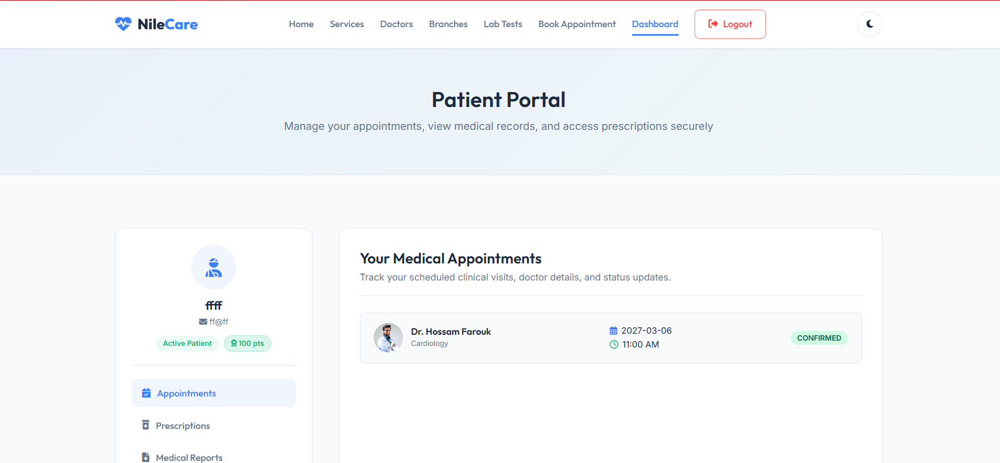
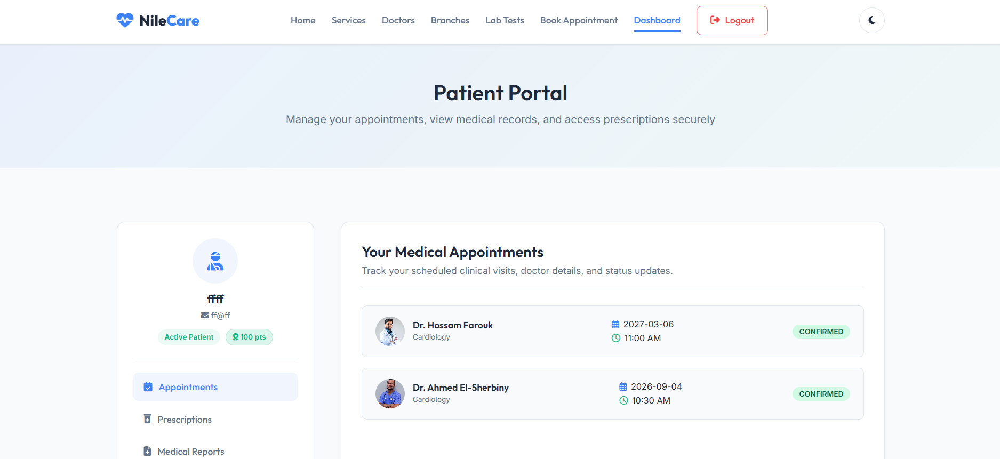

# NileCare - Security Findings

**Application:** NileCare / Egyptian Specialist Hospital

**Assessment period:** 25-29 October 2026

**Report version:** 2.1

## Overview

The assessment identified **six confirmed vulnerabilities** in the NileCare patient portal. These affect uploaded medical attachments, appointment authorization, doctor-directory data, laboratory discounts, password recovery and medical-report rendering.

The password-recovery flaw allows an unauthenticated requester to obtain a recovery link and take over an account. The booking IDOR permits appointment creation under another patient's identity. Two separate stored-XSS vulnerabilities execute JavaScript through uploaded HTML attachments and medical-report fields. The lab-booking workflow accepts an unauthorized client-supplied discount, while the public doctors API exposes staff email addresses and related directory records.

The report contains the team's reproduction steps, affected endpoints, impact and remediation for these six findings. Screenshots accompany the available demonstrations. The `/api/doctors` response is documented without a screenshot, as none was supplied. Passwords, signing secrets, usable session cookies and reset-token values are excluded.

### Remediation priorities
1. Fix password recovery and enforce patient ownership throughout the appointment-booking workflow.
2. Prevent active HTML in uploaded attachments and encode all medical-report fields at output.
3. Compute laboratory prices and discounts on the server, and remove unnecessary staff contact data from public API responses.

| ID | Finding | Status |
|---|---|---|
| 01 | Stored Cross-Site Scripting (XSS) - Attachment Upload | Confirmed |
| 02 | Insecure Direct Object Reference (IDOR) | Confirmed |
| 03 | Information Disclosure - Doctor Details and Email Addresses | Confirmed |
| 04 | Business Logic Flaw - Client-Controlled Discount | Confirmed |
| 05 | Forgot Password - Unauthenticated Password Reset / Account Takeover | Confirmed |
| 06 | Stored Cross-Site Scripting (XSS) - Medical Report Fields | Confirmed |

---

## 01 | Stored Cross-Site Scripting (XSS) - Attachment Upload

**Affected components:** `POST /reports/upload-attachment`, `/static/uploads/attachments/<uploaded-file>`

**CVSS 3.1 vector:** `CVSS:3.1/AV:N/AC:L/PR:L/UI:R/S:U/C:H/I:H/A:N`

**Status: Confirmed**

The medical-attachment uploader accepts a JPEG/HTML polyglot whose filename contains an allowed image extension but ends in .html. The file is stored publicly and served as HTML. Opening the uploaded URL executes attacker-controlled JavaScript in the NileCare origin.

### Affected input and behavior
The multipart input is `attachment`. The demonstrated filename pattern is `king.jpg.html`, with declared content type `image/jpeg` and JPEG signature bytes followed by HTML and JavaScript. The upload filter accepts the image extension appearing inside the filename; the final `.html` extension causes the stored content to be served as `text/html` with inline disposition.

### Steps to reproduce
1. Sign in to the patient portal and open the attachment-upload form.
2. Prepare JPEG-header content followed by benign HTML and an alert using `document.domain` or `window.origin`.
3. Upload it as `king.jpg.html` through the `attachment` field.
4. Follow the uploaded-file link under `/static/uploads/attachments/`.
5. Observe the browser alert displaying the NileCare origin.

### Request and response
```http
POST /reports/upload-attachment HTTP/1.1
Host: tan-clinic-mono-flood.trycloudflare.com
Cookie: session=[REDACTED]
Content-Type: multipart/form-data; boundary=NileCareEvidence

--NileCareEvidence
Content-Disposition: form-data; name="attachment"; filename="king.jpg.html"
Content-Type: image/jpeg

[JPEG header bytes followed by HTML and a benign alert script]
--NileCareEvidence--
```
The server redirects to `/dashboard` after upload. Retrieving the uploaded URL returns `200 OK` with `Content-Type: text/html` and an inline content disposition.

### Impact
Stored, same-origin JavaScript can read page content, alter displayed information and issue authenticated requests in a logged-in visitor's context. The malicious content remains available at its uploaded URL. The demonstrated interaction is opening the attachment link.

### Evidence


### Recommendation

Validate the final filename extension against an allowlist and verify file content. Decode and re-encode uploaded images, generate server-side storage names, and keep medical attachments outside the public web root. Serve files through an authorization-checked download route and prevent user uploads from becoming active HTML on the application origin. Add a restrictive CSP and `X-Content-Type-Options: nosniff` as additional controls.

### References

- [https://cwe.mitre.org/data/definitions/79.html](https://cwe.mitre.org/data/definitions/79.html)
- [https://cwe.mitre.org/data/definitions/434.html](https://cwe.mitre.org/data/definitions/434.html)
- [https://cheatsheetseries.owasp.org/cheatsheets/File_Upload_Cheat_Sheet.html](https://cheatsheetseries.owasp.org/cheatsheets/File_Upload_Cheat_Sheet.html)

---

## 02 | Insecure Direct Object Reference (IDOR)

**Affected components:** `POST /book`

**CVSS 3.1 vector:** `CVSS:3.1/AV:N/AC:L/PR:N/UI:N/S:U/C:N/I:H/A:N`

**Status: Confirmed**

The appointment-booking workflow allows client-controlled patient identity to be changed so that a booking is recorded under another patient's account. The team demonstrated the effect with two test accounts and verified the additional appointment in the target account's dashboard.

### Technical details
The test used the account `kk@kk` to initiate the booking and `ff@ff` as the target test identity. The session data exposes identity fields including `user_id`, `patient_name` and `patient_email`. Altering the client-supplied identity used by the booking request changed the account under which the appointment was created. The authorization failure is the ability to create an appointment for a different account through this manipulated identity.

Example identity structure, with no usable session token:
```json
{
  "patient_email": "<target-test-account>",
  "patient_name": "<target-test-name>",
  "user_id": "<target-test-user-id>"
}
```

### Steps to reproduce
1. Sign in with the initiating test account and capture a booking request in Burp Suite.
2. Inspect the session's patient identity data.
3. Modify the identity fields to those of the second test account and prepare the modified session value used in the team's test.
4. Submit the booking through `POST /book` with that modified value.
5. Observe `302 Found` redirecting to `/dashboard`.
6. Sign in normally as the target test account and verify the new appointment in its dashboard.

Request outline:
```http
POST /book HTTP/1.1
Host: tan-clinic-mono-flood.trycloudflare.com
Cookie: session=[REDACTED]
Content-Type: application/x-www-form-urlencoded

name=<test-name>&email=<test-email>&phone=<test-phone>&doctor_id=<doctor>&date=<date>&time=<time>&notes=
```

### Impact
Unauthorized appointment creation violates patient-record integrity and permits impersonation in the booking workflow. It also allows unwanted appointments to consume clinic scheduling capacity.

**Discovered and tested by:** Abdulaziz Soltan, aka k0rdz.

### Evidence





### Recommendation

Derive the booking owner from a trusted, verified authenticated identity on the server. Reject a client-supplied patient identity that does not match the authorized account. Enforce object-level authorization for every booking operation, validate the integrity of session data, and use revocable server-side session state or equally strong signed-session controls. Include two-account authorization checks in regression testing.

### References

- [https://cwe.mitre.org/data/definitions/862.html](https://cwe.mitre.org/data/definitions/862.html)
- [https://cheatsheetseries.owasp.org/cheatsheets/Authorization_Cheat_Sheet.html](https://cheatsheetseries.owasp.org/cheatsheets/Authorization_Cheat_Sheet.html)

---

## 03 | Information Disclosure - Doctor Details and Email Addresses

**Affected components:** `GET /api/doctors`

**CVSS 3.1 vector:** `CVSS:3.1/AV:N/AC:L/PR:N/UI:N/S:U/C:L/I:N/A:N`

**Status: Confirmed**

The unauthenticated doctors API exposes structured records for 22 doctors, including their email addresses under @nilecare.com.eg. The response also contains names, specialties, schedules, experience and biographical details. Any visitor can retrieve the records without a session.

### Steps to reproduce
1. Open a client without an authenticated session.
2. Send a GET request to `/api/doctors`.
3. Inspect the JSON response and the email field in each doctor record.

```http
GET /api/doctors HTTP/1.1
Host: tan-clinic-mono-flood.trycloudflare.com
Accept: application/json
```

### Exposed data
The documented response contains 22 records with doctor names, specialties, biographies, years of experience, ratings, weekly schedules and email addresses. The email domain is `nilecare.com.eg`.

### Impact
Unauthenticated users can collect the doctors' contact details and schedules in bulk. The disclosed addresses support targeted phishing, impersonation and unsolicited contact.

### Evidence
The endpoint and response fields are documented in the team's assessment. A screenshot of this API response was not supplied.

### Recommendation

Remove unnecessary email and staff-contact fields from unauthenticated API responses. Return only the attributes needed by the public directory and require appropriate authorization for additional staff data. Apply response minimization, access logging and suitable request limits.

### References

- [https://cwe.mitre.org/data/definitions/862.html](https://cwe.mitre.org/data/definitions/862.html)
- [https://cheatsheetseries.owasp.org/cheatsheets/Authorization_Cheat_Sheet.html](https://cheatsheetseries.owasp.org/cheatsheets/Authorization_Cheat_Sheet.html)

---

## 04 | Business Logic Flaw - Client-Controlled Discount

**Affected components:** `POST /lab-tests/book`

**CVSS 3.1 vector:** `CVSS:3.1/AV:N/AC:L/PR:L/UI:N/S:U/C:N/I:H/A:N`

**Status: Confirmed**

The lab-booking endpoint trusts the discount_pct parameter supplied by the client instead of calculating the permitted discount on the server. A valid promotion code can be combined with an altered percentage to reduce the payable price beyond the code's intended discount.

### Technical details
The booking request contains `test_id`, `discount_pct` and `discount_code`. The documented controlled test combines the public code `NILECARE10` with `discount_pct=90`, and the server records a 90% discount. Invalid promotion codes are rejected, but accepting a valid code does not restrict the supplied percentage to that code's actual allowance.

### Steps to reproduce
1. Sign in and select a laboratory test.
2. Capture the request to `/lab-tests/book`.
3. Retain a valid discount code and replace `discount_pct` with a larger percentage.
4. Submit the modified request.
5. Verify the reduced payable price in the success message and stored booking.

```http
POST /lab-tests/book HTTP/1.1
Host: tan-clinic-mono-flood.trycloudflare.com
Cookie: session=[REDACTED]
Content-Type: application/x-www-form-urlencoded

test_id=1&discount_pct=90&discount_code=NILECARE10
```

### Impact
A patient can obtain an unauthorized reduction in laboratory-test prices. The supplied team screenshot shows an Abdominal Ultrasound successfully booked for **0 EGP**, demonstrating the financial impact of manipulated booking prices.

### Evidence


### Recommendation

Calculate the discount and final price on the server using trusted product prices and promotion rules. Ignore client-provided percentages, validate code eligibility and usage limits, and use exact currency arithmetic. Audit anomalous bookings and test that changing discount_pct cannot change the server-authorized amount.

### References

- [https://cwe.mitre.org/data/definitions/602.html](https://cwe.mitre.org/data/definitions/602.html)
- [https://cwe.mitre.org/data/definitions/840.html](https://cwe.mitre.org/data/definitions/840.html)

---

## 05 | Forgot Password - Unauthenticated Password Reset / Account Takeover

**Affected components:** `POST /forgot-password`, `GET/POST /reset-password`

**CVSS 3.1 vector:** `CVSS:3.1/AV:N/AC:L/PR:N/UI:N/S:U/C:H/I:H/A:N`

**Status: Confirmed**

The password-recovery endpoint returns the password-reset link directly in its HTTP response. An unauthenticated requester can obtain that link for a known account and set a new password without access to the account's mailbox. The same token remains usable after a successful reset.

### Steps to reproduce
1. Submit the controlled account's email to `/forgot-password` without authentication.
2. Inspect the response body and obtain the reset URL.
3. Open that URL and set a replacement password.
4. Sign in using the replacement password.
5. Reuse the same reset URL and repeat the reset, demonstrating that successful use did not consume the token.

The request submits the `email` form field to `POST /forgot-password`. The response discloses a link in the form `/reset-password?token=[REDACTED]`.

### Impact
Knowing the account's email is sufficient to obtain a reset capability and replace its password. Token reuse allows the account to be compromised again using the same recovery link after the password changes. HTTPS does not prevent this application-level disclosure to the requester.

### Evidence
The team supplied the reset-response, reset-form and first/second-use captures: `Screenshot 2026-10-29 044404.png`, `044601.png`, `053958.png` and `054031.png`. Usable reset-token and session values are excluded from the distributed report.

**Discovered and tested by:** Abdulaziz Soltan, aka k0rdz.

### Recommendation

Do not return a reset capability in the requesting client's response. Deliver it only through a verified recovery channel and return a generic browser message. Generate high-entropy tokens with a short expiry, store a hash, consume each token atomically after one successful reset, and invalidate older tokens when issuing a new one. Revoke relevant sessions after credential recovery and notify the account owner.

### References

- [https://cwe.mitre.org/data/definitions/640.html](https://cwe.mitre.org/data/definitions/640.html)
- [https://cheatsheetseries.owasp.org/cheatsheets/Forgot_Password_Cheat_Sheet.html](https://cheatsheetseries.owasp.org/cheatsheets/Forgot_Password_Cheat_Sheet.html)

---

## 06 | Stored Cross-Site Scripting (XSS) - Medical Report Fields

**Affected components:** `POST /reports/create`, `GET /api/v1/reports/view`, `Fields: title, lab, report_file`

**CVSS 3.1 vector:** `CVSS:3.1/AV:N/AC:L/PR:L/UI:R/S:C/C:L/I:L/A:N`

**Status: Confirmed**

The Report Title, Laboratory / Facility and Report Details / Content fields store attacker-controlled HTML. The dashboard list displays the saved values as text, but the report view renders the same values as active HTML. Hovering over an injected link executes JavaScript in the NileCare origin. This stored XSS is separate from the attachment-upload vulnerability.

### Technical details
The affected inputs are `title`, `lab` and `report_file` in the Create Medical Report form. Contextual output encoding is missing on `/api/v1/reports/view`, allowing a stored anchor element and its `onmouseover` handler to be interpreted by the browser.

The test used the following payload forms; the submitted screenshots also show literal backslash characters around the markup:
```html
<!-- Report Title -->
<a onmouseover="alert(document.cookie)">xxs here</a>
<!-- Laboratory / Facility -->
<a onmouseover="alert(document.cookie)">and xxs here</a>
<!-- Report Details / Content -->
<a onmouseover="alert(document.cookie)">and another xxs here</a>
```

### Steps to reproduce
1. Sign in as a patient and open the Dashboard.
2. Click **New Report** under Lab Results & Medical Reports.
3. Enter the payloads in Report Title, Laboratory / Facility and Report Details / Content, then save.
4. Confirm the new report appears in the dashboard with the payload displayed as text.
5. Click **View** to open the report.
6. Hover over an injected link. The browser displays a JavaScript alert from the NileCare origin.

### Impact
Stored report data executes JavaScript when the report is viewed and the injected element is triggered. This enables page-content manipulation, phishing content and same-origin actions in the viewer's session. The demonstrated `document.cookie` alert is empty; the evidence establishes script execution without asserting theft of the HttpOnly session cookie.

### Evidence


### Recommendation

Apply contextual output encoding to title, laboratory, status and report content wherever they are rendered. Enable template autoescaping and avoid unsafe Markup, safe filters and HTML insertion for plain-text fields. If rich text is required, use a maintained allowlist sanitizer. Add a restrictive CSP that blocks inline scripts and event handlers, and retain HttpOnly, Secure and SameSite session protections.

### References

- [https://cwe.mitre.org/data/definitions/79.html](https://cwe.mitre.org/data/definitions/79.html)
- [https://cheatsheetseries.owasp.org/cheatsheets/Cross_Site_Scripting_Prevention_Cheat_Sheet.html](https://cheatsheetseries.owasp.org/cheatsheets/Cross_Site_Scripting_Prevention_Cheat_Sheet.html)
